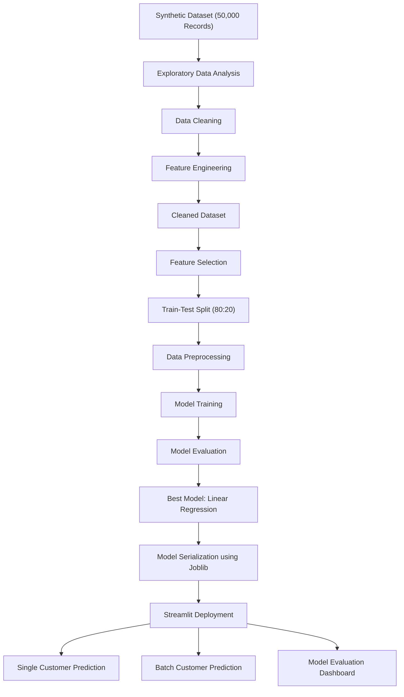

# 🛍️ ShopSmart — Customer Spend Prediction

**Team Code Poison | HCLTech Hackathon**

ShopSmart is an end-to-end Machine Learning project designed to predict customer spending based on demographic information, income, website activity, previous purchases, membership type, preferred category, city tier, and discount usage.

The project covers the complete ML pipeline, from synthetic data preparation and Exploratory Data Analysis (EDA) to data cleaning, feature engineering, model training, evaluation, and deployment through an interactive Streamlit application.

---

## 1. Problem Statement

Understanding customer spending patterns helps businesses identify customer segments and make informed decisions.

ShopSmart aims to predict the amount a customer spends based on eight customer attributes using supervised machine learning regression techniques.

**Objective:** Predict customer spending using historical customer characteristics and purchasing behaviour.

**ML Task:** Regression

**Target Variable:** `Amount_Spent`

---

## 2. Project Workflow



---

## 3. Dataset Description

The project uses a synthetic customer dataset containing approximately **50,000 records**.

Synthetic data provides a controlled environment for developing and testing the machine learning pipeline.

### Input Features

| Feature | Description | Type |
|---|---|---|
| Age | Customer age | Numerical |
| Annual_Income | Annual income | Numerical |
| Website_Visits | Number of website visits | Numerical |
| Previous_Purchases | Number of previous purchases | Numerical |
| Membership_Type | Membership category | Categorical |
| Preferred_Category | Preferred shopping category | Categorical |
| City_Tier | Customer city classification | Categorical |
| Discount_Used | Whether a discount was used | Categorical |

### Target Variable

`Amount_Spent` – Customer spending amount.

### Additional Engineered Features

- `Amount_Spent_Range`: Divides customers into five spending categories using quantiles.
- `Age_Group`: Groups customers based on age.

These additional features are used for exploratory analysis and segmentation but excluded from the final model inputs.

---

## 4. Exploratory Data Analysis (EDA)

Performed using `SyntheticDataEDA (1).ipynb`.

The EDA stage focuses on understanding the dataset, identifying patterns, and examining relationships between customer attributes and spending behaviour.

### Activities Performed

1. Dataset inspection and statistical summaries.
2. Missing-value identification.
3. Numerical feature distribution analysis.
4. Correlation analysis using heatmaps.
5. Spending pattern analysis.
6. Customer segmentation based on age and spending.
7. Category-wise and membership-wise spending analysis.

### Visualizations

- Correlation heatmap.
- Annual income distribution.
- Customer spending distribution.
- Category-wise spending analysis.
- Age-group spending analysis.
- Membership-type spending comparison.

---

## 5. Data Cleaning and Feature Engineering

Performed using `data_cleaning_shopsmart.ipynb`.

### Missing Value Treatment

| Feature | Technique |
|---|---|
| Annual_Income | Median Imputation |
| Website_Visits | Median Imputation |
| Membership_Type | Mode Imputation |
| Preferred_Category | Mode Imputation |

### Outlier Analysis

The Interquartile Range (IQR) method is used to identify potential outliers.

Steps:
- Calculate Q1 and Q3.
- Calculate IQR.
- Determine lower and upper bounds.
- Identify and visualize potential outliers using boxplots.

### Feature Engineering

Two additional features are created:

**1. Age_Group**

Customers are divided into age-based segments.

**2. Amount_Spent_Range**

Customers are divided into five quantile-based spending categories:

- Very Low
- Low
- Medium
- High
- Very High

The cleaned dataset is exported into CSV format for subsequent model training.

---

## 6. Model Development

Performed using `Model_Training.ipynb`.

### Feature Selection

Eight independent variables are used to predict the target variable `Amount_Spent`.

The engineered columns `Amount_Spent_Range` and `Age_Group` are excluded from model training.

### Train-Test Split

- Training Data: 80%
- Testing Data: 20%
- Random State: 42

### Models Explored

| Model | Description |
|---|---|
| Linear Regression | Baseline regression model |
| Decision Tree Regressor | Tree-based regression |
| Tuned Decision Tree | Hyperparameter optimization |
| Random Forest Regressor | Ensemble learning approach |

RandomizedSearchCV is used for hyperparameter tuning of tree-based models.

### Model Comparison

Recorded test RMSE values:

| Model | RMSE |
|---|---:|
| Linear Regression | 844.20 |
| Tuned Random Forest | 981.26 |
| Tuned Decision Tree | 1237.52 |
| Decision Tree | 1442.00 |

**Selected Model: Linear Regression**

Linear Regression achieved the lowest recorded RMSE among the evaluated models and was selected for the final deployment.

---

## 7. Model Preprocessing and Training

The deployment-ready implementation is maintained in `model.py`.

### Numerical Preprocessing
- Missing values handled using median imputation.

### Categorical Preprocessing
- Missing values replaced with `Unknown`.
- One-Hot Encoding applied.
- First category dropped as the baseline.
- Unseen categories handled using `handle_unknown="ignore"`.

### Model Pipeline

```python
pipeline = Pipeline([
    ("preprocessing", preprocessing),
    ("model", LinearRegression())
])

pipeline.fit(x_train, y_train)
```

The complete preprocessing and prediction pipeline is saved using Joblib.

### Generated Artifacts

- `model.pkl` – Trained model and preprocessing pipeline.
- `metrics.json` – Evaluation metrics and training metadata.
- `evaluation.csv` – Actual values, predictions, and residuals.
- `evaluation.png` – Model evaluation visualizations.

---

## 8. Model Evaluation

The selected Linear Regression model is evaluated using four regression metrics.

| Metric | Description |
|---|---|
| MAE | Mean Absolute Error |
| MSE | Mean Squared Error |
| RMSE | Root Mean Squared Error |
| R² | Coefficient of Determination |

### Final Model Performance

| Metric | Test Result |
|---|---:|
| MAE | 648.30 |
| MSE | 712,679.63 |
| RMSE | 844.20 |
| R² Score | 0.9494 |

Additional results:

- Training Records: 40,000
- Testing Records: 10,000
- Training R²: 0.9501
- Mean Prediction Benchmark RMSE: 3,751.86

The evaluation dashboard includes:
- Actual vs Predicted Plot.
- Residual Plot.
- Model Metrics.
- Benchmark Comparison.

**Note:** These are reproduced notebook results, not an independent post-selection test estimate. The dataset is synthetic, and the spending period and currency are undocumented. Therefore, these results should not be interpreted as proof of real-world future-spend forecasting performance.

---

## 9. Streamlit Deployment

The project includes an interactive Streamlit application implemented in `app.py`.

### Application Features

**1. Customer Spend Estimation**

- Enter customer information.
- Select categorical attributes.
- Generate individual spending predictions.
- View the estimated spending amount.

**2. Batch Predictions**

- Upload customer records through CSV.
- Generate predictions for multiple customers.
- View predictions in tabular format.
- Download the predicted results as CSV.

**3. Model Evaluation Dashboard**

- Display MAE, MSE, RMSE, and R².
- Compare the model against the mean-prediction benchmark.
- Visualize actual vs predicted values.
- Analyze residuals.
- Download evaluation metrics.

### Application Screenshots

Add your Streamlit screenshots here:

```markdown


```

---

## 10. Project Structure

```text
ShopSmart/
│
├── data/
│   ├── ShopSmart_synthetic_50000.csv
│   └── ShopSmart_synthetic_cleaned.csv
│
├── notebooks/
│   ├── SyntheticDataEDA (1).ipynb
│   ├── data_cleaning_shopsmart.ipynb
│   └── Model_Training.ipynb
│
├── notebook_demo/
│   ├── __init__.py
│   ├── app.py
│   ├── model.py
│   ├── verify.py
│   └── requirements.txt
│
├── artifacts/
│   └── notebook_demo/
│       ├── model.pkl
│       ├── metrics.json
│       ├── evaluation.csv
│       └── evaluation.png
│
├── requirements.txt
└── README.md
```

---

## 11. Installation and Execution

### Step 1: Clone Repository

```bash
git clone <YOUR_GITHUB_REPOSITORY_URL>
cd ShopSmart
```

### Step 2: Create Virtual Environment

```bash
python -m venv .venv
```

Activate environment:

**Windows**
```bash
.venv\Scripts\activate
```

**macOS / Linux**
```bash
source .venv/bin/activate
```

### Step 3: Install Dependencies

```bash
pip install -r requirements.txt
```

### Step 4: Run Notebooks

Execute notebooks in the following order:

1. `SyntheticDataEDA (1).ipynb`
2. `data_cleaning_shopsmart.ipynb`
3. `Model_Training.ipynb`

Ensure that the CSV paths referenced in the notebooks are updated according to your local environment.

### Step 5: Train the Deployment Model

```bash
python -m notebook_demo.model --source "data/ShopSmart_synthetic_cleaned.csv"
```

This command trains the selected Linear Regression model and generates the required artifacts.

### Step 6: Verify Model

```bash
python -m notebook_demo.verify
```

### Step 7: Launch Streamlit

```bash
streamlit run notebook_demo/app.py
```

Open the local URL displayed in your terminal, usually:

`http://localhost:8501`

---

## 12. Technology Stack

| Category | Technologies |
|---|---|
| Programming Language | Python |
| Data Manipulation | Pandas, NumPy |
| Data Visualization | Matplotlib, Seaborn |
| Machine Learning | Scikit-learn |
| Model Persistence | Joblib |
| Deployment | Streamlit |
| Development Environment | Jupyter Notebook / JupyterLab |
| Version Control | Git and GitHub |

---

## 13. Future Scope

- Integrate real-world customer purchase data.
- Establish a clearly defined prediction horizon.
- Improve model validation using independent datasets.
- Implement customer segmentation and personalized recommendations.
- Add model monitoring and performance tracking.
- Explore advanced ensemble and boosting algorithms.
- Enhance the dashboard with business intelligence visualizations.

---

## 14. Team

**Team Name:** Code Poison  
**Team Members:** Amritesh Singh | Gaurav Rastogi | Naveli Gupta | Vyas Bhumit
**Event:** HCLTech Hackathon  
**Project:** ShopSmart – Customer Spend Prediction

---

## Disclaimer

ShopSmart is an educational and hackathon prototype developed using synthetic customer data. Predictions represent model estimates in the source dataset's units and should not be treated as verified customer spending forecasts or guaranteed business outcomes.
