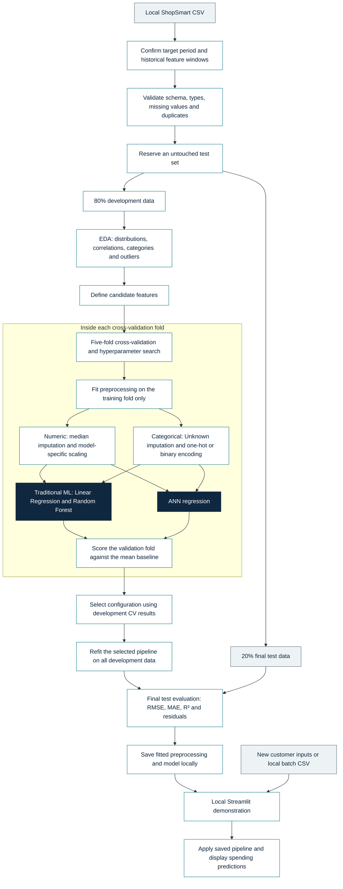

# ☠️ Code Poison

### HCLTech Placement Hackathon

Welcome to the official repository of **Team Code Poison**, participating in the HCLTech Placement Hackathon.

We are a team of four enthusiastic individuals passionate about technology, innovation, and problem-solving. Our goal is to collaborate, think creatively, and develop practical, technology-driven solutions to real-world challenges.

## 👥 Team Members

| S. No. | Name |
|:---:|---|
| 1 | Amritesh Singh |
| 2 | Naveli Gupta |
| 3 | Gaurav Rastogi |
| 4 | Bhumit Vyas |

## 🎯 Our Mission

- Solve real-world problems through technology.
- Develop innovative and efficient solutions.
- Apply analytical and technical skills.
- Collaborate effectively and learn together.
- Deliver impactful results within the hackathon timeline.

## 💡 Our Approach

**Think. Innovate. Collaborate. Build.**

We believe that great solutions come from combining diverse ideas, strong teamwork, and continuous experimentation.

## 🏆 Event

**HCLTech Placement Hackathon – 2026**

---

*Built with teamwork, creativity, and a little bit of Code Poison! ☠️*

## Customer Spend Prediction Workflow

**Option B — ShopSmart Customer Spend Prediction**

Our goal is to predict customer spending using demographics, historical purchases, and engagement. This is the agreed design for the build; model results are not yet available.

### Workflow flowchart

### How we will proceed

1. **Define and validate.** Preserve the raw CSV, document column meanings, confirm feature and target timing, and record reproducible split identifiers.
2. **Explore and prepare.** Use development data for EDA. Investigate outliers, retain valid extremes, and test justified feature additions.
3. **Train and compare.** Establish a mean-prediction baseline, then compare Linear Regression, Random Forest, and ANN using the same outer validation folds. ANN architecture remains unspecified at this stage.
4. **Tune and evaluate.** Tune within development cross-validation. Use RMSE for selection and report MAE, R², fold variability, actual-versus-predicted plots, residuals, segment errors, and feature importance.
5. **Demonstrate locally.** Save the complete fitted pipeline and reuse it for Streamlit predictions. Verify that script and UI predictions agree for identical inputs.

### Preprocessing decisions

| Input type | Planned treatment |
|---|---|
| Numeric missing values | Impute training-fold medians; evaluate missingness indicators. |
| Categorical missing values | Fill with an explicit Unknown category. |
| Membership, preferred category, city tier | Apply one-hot encoding with consistent unseen-category handling. |
| Discount usage | Map Yes/No to a binary value. |
| Numeric scaling | Standardise inputs for linear and ANN models; Random Forest does not require scaling. |
| Outliers | Correct confirmed errors and retain genuine extremes. Learn any statistical thresholds within training folds. |

### Validation and scope

- **Timing must be confirmed.** The supplied file has no customer IDs or dates, and `Amount_Spent` has no stated period. Until the provider confirms that inputs precede the target month, describe the result as a spending prediction prototype rather than validated next-month forecasting.
- **The split is provisional.** An 80/20 random split with shuffled five-fold development CV assumes independent customer records. Use chronological validation for dated observations and group-aware splitting when needed for the evaluation objective.
- **Prevent leakage.** Fit imputation, encoding, scaling, statistical thresholds, and feature selection inside each training fold. Transform validation and test data with the fitted steps. Never use final test performance to tune the model.
- **Keep the demonstration local.** The CSV, trained model, and Streamlit application run on a laptop. Flask, FastAPI, Docker, cloud deployment, and dataset hosting are outside this presentation scope.

### Four-person ownership

| Workstream | Responsibility |
|---|---|
| Member 1 — Data and preprocessing | Data dictionary, validation, split manifest, reusable preprocessing. |
| Member 2 — EDA and evaluation | Exploration, feature hypotheses, metrics, explanations, documentation. |
| Member 3 — Traditional ML | Baselines, traditional models, tuning, selected pipeline packaging. |
| Member 4 — ANN and demonstration | ANN comparison, local Streamlit interface, prediction integration. |

**First build milestone:** confirm the target contract, freeze the shared split, and run a reproducible baseline through the preprocessing pipeline.
