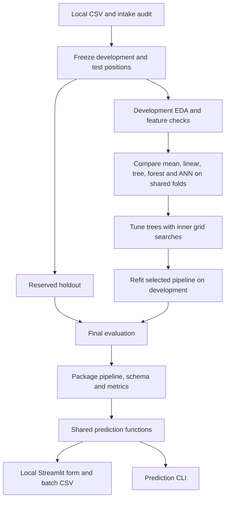

# ☠️ Code Poison

### HCLTech Placement Hackathon

Welcome to the official repository of **Team Code Poison**, participating in the HCLTech Placement Hackathon.

We are a team of four enthusiastic individuals passionate about technology, innovation, and problem-solving. Our goal is to collaborate, think creatively, and develop practical, technology-driven solutions to real-world challenges.

## 👥 Team Members

| S. No. | Name |
|:---:|---|
| 1 | Amritesh Singh |
| 2 | Naveli Gupta |
| 3 | Gaurav Rastogi |
| 4 | Bhumit Vyas |

## 🎯 Our Mission

- Solve real-world problems through technology.
- Develop innovative and efficient solutions.
- Apply analytical and technical skills.
- Collaborate effectively and learn together.
- Deliver impactful results within the hackathon timeline.

## 💡 Our Approach

**Think. Innovate. Collaborate. Build.**

We believe that great solutions come from combining diverse ideas, strong teamwork, and continuous experimentation.

## 🏆 Event

**HCLTech Placement Hackathon – 2026**

---

*Built with teamwork, creativity, and a little bit of Code Poison! ☠️*


## ShopSmart Customer Spend Prediction

**New notebook-based demo:** [Interactive eight-input Streamlit app](notebook_demo/README.md) reproduces the Linear Regression winner from `Untitled5.ipynb`, with customer and batch inputs, downloadable predictions, evaluation metrics and plots. Run `python -m streamlit run notebook_demo/app.py --server.address 127.0.0.1 --server.port 8530` after its documented training command. This separate demo includes timing-uncertain historical fields; its scores must not be confused with the four-input prototype below.

Option B estimates a customer's spending from age, annual income, membership and city tier. The local demonstration uses Linear Regression. On 10,000 held-out synthetic profiles it achieved RMSE **1,862.11**, MAE **1,484.88** and R² **0.754**. The data provider has yet to confirm currency, observation windows and target period. The results apply to the supplied synthetic population.

### Install and run

From the repository root on Windows, use Python 3.12.14. Create the environment once:

```powershell
py -3.12 -m venv .venv
& .\.venv\Scripts\python.exe -m pip install -r requirements.txt
```

Run the complete workflow with this single command. Adjust the CSV path on another laptop. The intake verifies the supplied snapshot and preserves it locally. Each subsequent stage uses the same Python interpreter.

```powershell
& .\.venv\Scripts\python.exe -m scripts.run_workflow --source "C:/Users/gr251/OneDrive/Desktop/ShopSmart_synthetic_cleaned (1).csv"
```

Run the following commands for one prediction, batch inference, automated UI checks and the local demo:

```powershell
& .\.venv\Scripts\python.exe -m scripts.predict --dual --row '{"Age":35,"Annual_Income":700000,"Membership_Type":"Silver","City_Tier":"Tier 2"}'
& .\.venv\Scripts\python.exe -m scripts.predict --dual --csv reports/generated/holdout/example_inputs.csv --out reports/generated/demo_predictions.csv
& .\.venv\Scripts\python.exe -m scripts.verify_demo
& .\.venv\Scripts\python.exe -m streamlit run app.py --server.address 127.0.0.1 --server.port 8527
```

The sample returns **17,102.72** and **Medium**. Batch uploads retain row order and identifier strings. The app displays the metrics stored beside the fitted pipeline. Generated files remain on the laptop.

### Workflow and design



Seed 42 reserves 20% for testing and fixes five development folds. Customer IDs and dates are unavailable, so validation assumes exchangeable synthetic rows. Learned transforms fit within each training fold. The target band, redundant age band and fields with uncertain historical timing are excluded. An optional log-income feature yielded no material gain.

| Submission detail | Where to find it |
|---|---|
| Data dictionary, numeric checks and provider questions | [Data intake](docs/data-intake.md) |
| Distribution, missingness, correlations, segment comparisons and feature decisions | [Development EDA](docs/development-eda.md) |
| Five candidate models, feature variants and ANN convergence | [Model comparison](docs/model-comparison.md) |
| Nested validation, grid values and selection criterion | [Model selection](docs/model-selection.md) |
| Holdout errors, high-spender limitation and interpretation | [Final evaluation](docs/final-evaluation.md) |
| Library purposes, model comparison table, tuning results, architecture, team workstreams and 60-second presentation | [Architecture and demo guide](docs/architecture.md) |
1. **Define and validate.** Preserve the raw CSV, document column meanings, confirm feature and target timing, and record reproducible split identifiers.
2. **Explore and prepare.** Use development data for EDA. Investigate outliers, retain valid extremes, and test justified feature additions.
3. **Train and compare.** Establish a mean-prediction baseline, then compare Linear Regression, Random Forest.
4. **Tune and evaluate.** Tune within development cross-validation. Use RMSE for selection and report MAE, R², fold variability, actual-versus-predicted plots, residuals, segment errors, and feature importance.
5. **Demonstrate locally.** Save the complete fitted pipeline and reuse it for Streamlit predictions. Verify that script and UI predictions agree for identical inputs.

Member 1 owns data validation and preprocessing. Member 2 owns EDA, error analysis and documentation. Member 3 owns traditional models, tuning and packaging. Member 4 owns ANN and the local Streamlit demonstration.

Local outputs include `data/prepared/development.csv`, `artifacts/spend_bundle.pkl`, `artifacts/metrics.json`, and plots under `reports/generated/eda/` and `reports/generated/holdout/`. Install instructions reproduce the pinned project dependencies. The verified workspace uses those versions in its existing parent virtual environment.

## Both website outputs

The form and CSV return Predicted_Amount_Spent and Predicted_Amount_Spent_Range together. Read the [both-output specification](docs/dual-output.md) for fold-local thresholds and original-label evaluation. Final range accuracy is **53.00%**, macro-F1 **0.53850**, and **6.68%** of predictions miss by at least two bands. [Aggregate comparisons](docs/results/comparison.csv) include runtime and default-versus-tuned results. Run `python -m unittest discover -s tests -v` and `python -m scripts.verify_demo` for contract and UI checks. Customer CSVs, row-level outputs and serialized models remain local.

## Completed implementation and notebook handoff

The project implements intake and data validation, a fingerprinted 80/20 split, five shared development folds, fold-local preprocessing, development-only EDA, original-versus-log-income comparisons, five regression candidates, nested grid searches for both tree models, final holdout evaluation, consistent amount and range outputs, a saved schema and pipeline bundle, shared single/batch inference, and a local Streamlit demo. Automated checks cover serialization, prediction consistency, missing fields, unseen categories and all four band boundaries.

There are 14 generated notebook exports in the [notebook source index](notebooks/README.md). Each contains the corresponding Python source in readable code cells with no stored execution outputs. Python entry points remain available for Streamlit and the reproducible workflow. The teammate notebooks are preserved.

The handoff includes a GitHub-ready ZIP of code, notebooks, documentation and aggregate results, plus a complete ZIP with a separate local_only folder for datasets, fitted models and row-level results. Upload only the repository folder to GitHub. The supplied currency and target period still require provider confirmation.
