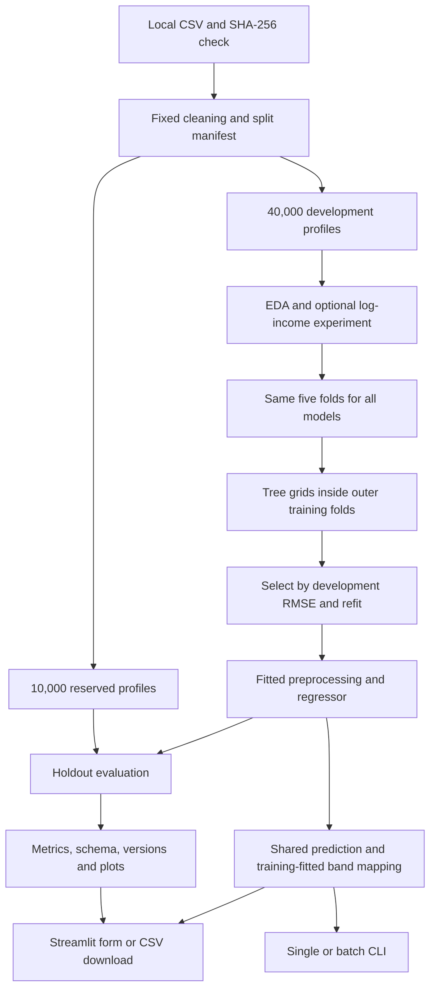

# ShopSmart architecture and submission

Team Code Poison estimates a customer's spending from their profile for a local revenue-planning demonstration. The supplied synthetic data has an unspecified spending period and currency. The packaged estimator is Linear Regression.

**Data contract.** Each row represents a synthetic profile. The [11-field dictionary](data-intake.md) records inferred meanings, units, missingness and timing. The inputs are age, annual income, membership and city tier. Purchases, visits, discounts and preference await confirmation of their measurement windows. Spend band reveals the target and age group repeats age. The 50,000 records have no IDs or dates. The random split assumes exchangeable synthetic records. Real customer generalisation and future-period performance remain open questions.

**Training.** Fingerprinted row positions and seed 42 fix the holdout and five development folds. Each fold fits its own numeric median imputer, categorical Unknown imputer, encoder and optional numeric scaler. Linear Regression and ANN use scaled inputs. Decision Tree and Random Forest use unscaled inputs. The ANN also transforms its training targets and returns predictions in original units. [EDA](development-eda.md) compared category segments and checked leakage. A fold-safe log-income feature provided no meaningful improvement, so the final model uses the original four fields.

| Family | Original CV RMSE | With log income | Tuned outer CV RMSE |
|---|---:|---:|---:|
| Mean benchmark | 3,754.45 | 3,754.45 | — |
| Linear Regression | 1,882.40 | 1,882.46 | — |
| ANN | 1,886.94 | 1,888.61 | — |
| Random Forest | 1,938.75 | 1,938.75 | 1,906.57 |
| Decision Tree | 1,946.89 | 1,946.89 | 1,937.03 |

[Model comparison](model-comparison.md) records the fixed settings and ANN convergence checks. [Nested tuning](model-selection.md) searches complete pipelines on two inner folds within each outer training fold. Library-default RMSE was 2,728.65 for the tree and 2,106.29 for the forest. RMSE gives larger spending errors more weight. The lowest development RMSE selected Linear Regression before opening the holdout.

**Evaluation and interpretation.** Across 10,000 held-out profiles the winner scored RMSE 1,862.11, MAE 1,484.88 and R² 0.75367. The development-mean benchmark scored 3,751.86, 3,015.56 and approximately zero respectively. Holding other inputs fixed, 100,000 additional income units correspond to 1,027.91 more predicted spending units. Gold versus Bronze corresponds to 4,054.19 more. These are predictive associations. Of 1,014 high spenders above the development 90th-percentile threshold, 82.45% were underestimated. See [holdout evaluation](final-evaluation.md) for residual definitions, segment diagnostics and interpretation.

**Runtime and handoffs.** Python runs each stage. pandas reads CSVs and preserves identifiers, NumPy checks numerical parity, scikit-learn constructs pipelines and evaluates models, Matplotlib generates EDA and holdout figures, joblib reloads the pipeline, and Streamlit renders the local UI. SciPy supplies numerical routines and threadpoolctl limits parallel CPU work. Member 1 owns intake and preprocessing, Member 2 EDA, interpretation and documentation, Member 3 traditional models, tuning and packaging, and Member 4 ANN and the demo.

**Inference.** app.py reads the schema and metrics from local artifacts. Both clients call scripts.predict. Numeric blanks use training medians. Unknown categories use the saved encoder. Batch identifiers remain strings and output order matches input order. Streamlit processes uploaded bytes in memory. The local CLI writes only to the chosen output path. The dataset, models and generated results are Git-ignored. See the [README](../README.md) for installation and execution commands.

**60-second demonstration**

> We built ShopSmart to estimate spending from four customer profile fields. This is a local prototype because the synthetic file does not specify a spending period. I’ll enter age 35, income 700,000, Silver membership and Tier 2. The estimate is 17,102.72 spending units. A batch CSV runs through the same pipeline and returns each prediction beside its original identifier. We compared a mean benchmark, Linear Regression, two tree models and an ANN using the same five folds. Linear Regression won. On 10,000 reserved profiles, its average absolute error was 1,485 spending units, compared with 3,016 for the benchmark. The main weakness was high spenders: we underestimated about 82% of them. That limits how confidently we can use the estimate for that group.

## Amount and band outputs

The spend_bundle.pkl artifact stores the fitted pipeline, schema, labels, cutoffs and configuration. Both clients return the amount and its assigned range. The [range specification](dual-output.md) records exact boundary rules, original-label evaluation and performance.
